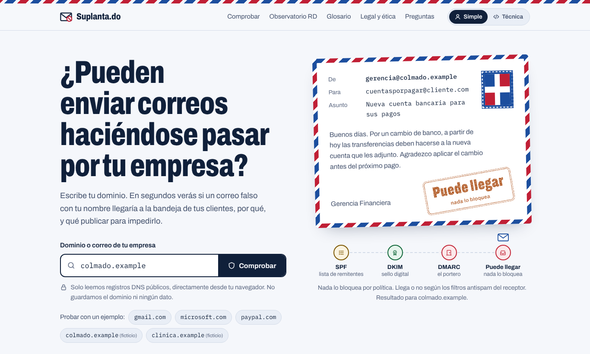
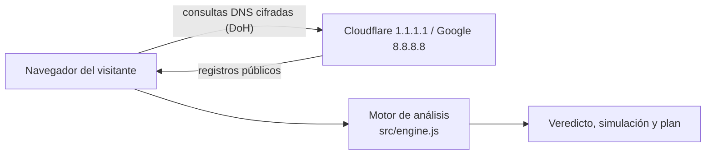

# Suplanta.do

**¿Pueden enviar correos haciéndose pasar por tu empresa?** Suplanta.do responde esa pregunta en segundos para cualquier dominio. Muestra qué haría Gmail u Outlook con un correo falsificado y entrega los registros DNS exactos para impedirlo.

Incluye el **primer observatorio público de suplantación de correo de República Dominicana**: 225 organizaciones, actualizado cada día con los datos al cierre del día anterior. En el primer corte, el 52% podía ser suplantado.

[](https://github.com/julioepujols/suplantado/actions/workflows/ci.yml)



## Qué hace

- **Veredicto en lenguaje claro.** Riesgo crítico, alto, medio o bajo, explicado para un dueño de empresa, no solo para el equipo de TI.
- **Simulación del correo falso.** Recorre SPF, DKIM y DMARC con los registros reales del dominio y muestra el destino: entregado, spam o rechazado. También simula la suplantación de un subdominio inventado.
- **Plan de corrección listo para copiar.** Registros SPF, DMARC (con plan gradual hasta `p=reject`), DKIM según el proveedor detectado, MTA-STS, TLS-RPT y CAA.
- **Detalle técnico completo.** Árbol de inclusiones SPF con el conteo de las 10 consultas permitidas, etiquetas DMARC, claves DKIM y su tamaño, MX, DNSSEC, BIMI y CAA.
- **Estándar actual.** Aplica DMARC según el RFC 9989 (mayo de 2026): modo prueba `t=y`, política `np` y aviso de etiquetas eliminadas como `pct`.

## Cómo funciona



Todo ocurre en el navegador. No hay servidor propio, base de datos ni cookies. Las métricas de visitas, si se activan, usan Cloudflare Web Analytics sin cookies y nunca ven el dominio consultado. El dominio consultado solo viaja a los resolvers DNS públicos, igual que en cualquier consulta DNS. Ver [arquitectura](docs/arquitectura.md).

## Seguridad por diseño

| Control | Implementación |
|---|---|
| Contenido DNS hostil | Todo dato externo se pinta con `textContent`; ningún registro se interpreta como HTML. Cubierto por prueba de extremo a extremo |
| Content Security Policy | `default-src 'none'`, scripts permitidos solo por hash SHA-256, `connect-src` limitado a los dos resolvers (más Cloudflare Web Analytics si se activa) |
| Sin terceros | Fuentes incrustadas y ningún rastreador. Único script externo: las métricas opcionales de Cloudflare Web Analytics, sin cookies |
| Cabeceras | HSTS, `frame-ancestors 'none'`, `nosniff`, `Referrer-Policy: no-referrer`, `Permissions-Policy` restrictiva |
| Cadena de suministro | Sin dependencias en producción; Playwright fijado como única dependencia de desarrollo |
| Verificación continua | Pruebas, Semgrep, gitleaks y OSV-Scanner en cada cambio |
| Revisión independiente | 6 hallazgos confirmados con prueba de concepto, todos corregidos con pruebas de regresión. Ver [revisión de seguridad](docs/revision-seguridad.md) |
| Accesibilidad | 0 violaciones WCAG 2.1 AA (axe-core) en modo claro y oscuro; navegable con teclado |

Modelo de amenazas completo: [docs/modelo-amenazas.md](docs/modelo-amenazas.md). Para reportar una vulnerabilidad: [SECURITY.md](SECURITY.md).

## Observatorio de República Dominicana

| Indicador | Resultado |
|---|---|
| Organizaciones analizadas | 225 (gobierno, banca, educación, salud, medios, telecom, empresas, transporte) |
| Pueden ser suplantadas (sin DMARC o en `p=none`) | 52% |
| Rechazan correos falsos (`p=reject`) | 26% |
| Sector más expuesto / más protegido | Salud 82% suplantable / Banca 16% |
| Publican MTA-STS | 2.2% |

Solo se publican cifras agregadas. Método, fuentes y limitaciones: [docs/metodologia.md](docs/metodologia.md).

## Desarrollo

Requisitos: Node.js 20 o superior.

```bash
npm ci                 # instala Playwright (solo desarrollo)
npm test               # pruebas unitarias y de abuso del motor
npm run build          # genera dist/site/ (sitio) y dist/artifact.html
npm run test:e2e       # pruebas en Chromium sobre el sitio generado
```

La URL pública y los datos de contacto se configuran en `site.config.json`.

## Estructura

```
src/            motor de análisis, interfaz y plantilla de la página
data/           agregado del observatorio y ejemplos embebidos
assets/         fuentes (licencia OFL) e imagen para compartir
scripts/        construcción y regeneración de ejemplos
test/           pruebas unitarias, de abuso y de extremo a extremo
docs/           arquitectura, metodología, modelo de amenazas, despliegue y decisiones
```

## Despliegue

Sitio estático: Cloudflare Pages (recomendado, aplica `_headers`) o GitHub Pages. Pasos en [docs/despliegue.md](docs/despliegue.md).

## Limitaciones

- DKIM no se puede listar desde fuera: se prueban 41 selectores comunes, así que la ausencia no prueba que no exista.
- DMARC protege el dominio exacto. No detiene dominios parecidos (`tuempresa-do.com`) ni cuentas legítimas robadas.
- El resultado describe la configuración DNS en el momento de la consulta; no es una auditoría ni una garantía.

## Licencia

Código publicado para revisión y portafolio. **Todos los derechos reservados**: no se permite copiar, modificar, redistribuir ni usar comercialmente sin autorización escrita. Ver [LICENSE](LICENSE). Las fuentes Archivo e IBM Plex Mono se distribuyen bajo la SIL Open Font License 1.1.

## English summary

Suplanta.do checks whether anyone can send email impersonating a domain. It reads only public DNS records (SPF, DKIM, DMARC per RFC 9989, MTA-STS, TLS-RPT, DNSSEC, CAA) over DNS-over-HTTPS, directly in the visitor's browser, with no backend, then simulates how a receiving server would treat a forged message and generates the exact DNS records to fix it. It also publishes the first email-spoofing observatory for the Dominican Republic: 52% of 225 organizations can be spoofed. Built with a strict hash-based CSP, no third-party scripts except optional cookie-free analytics, and unit, abuse, and end-to-end tests.

## Autor

**Julio Pujols**, ciberseguridad y desarrollo seguro, Santo Domingo, República Dominicana. [GitHub](https://github.com/julioepujols)
