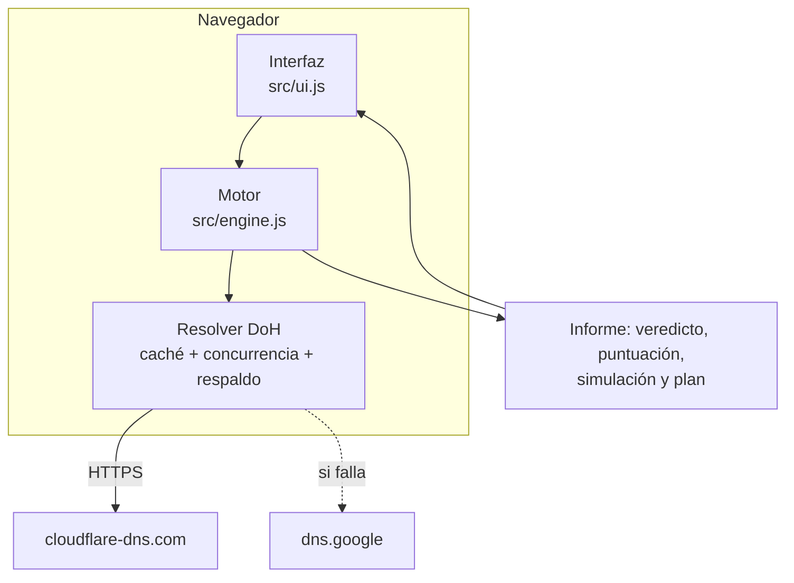

# Arquitectura

## Visión general

Suplanta.do es un sitio estático de un solo archivo HTML. La lógica corre completa en el navegador del visitante y consulta registros DNS públicos mediante DNS sobre HTTPS (DoH, RFC 8484, formato JSON).

## Componentes

| Archivo | Responsabilidad |
|---|---|
| `src/engine.js` | Normaliza la entrada, consulta DNS y evalúa SPF, DMARC, DKIM, MX y controles adicionales. Calcula el veredicto, la puntuación, la simulación y el plan. Es un módulo UMD sin dependencias que funciona igual en navegador y en Node. |
| `src/ui.js` | Pinta el informe (modo Simple o Técnico), el sobre con matasellos y el recorrido postal, el observatorio con su evolución, el glosario, la sección legal y el contacto. Construye todo el DOM con `textContent`. |
| `src/app.html` | Plantilla: estilos, estructura y marcadores que la construcción reemplaza. |
| `scripts/build.js` | Incrusta fuentes, motor, datos e interfaz; calcula los hashes SHA-256 de los scripts para la CSP y genera `dist/site/` (con `_headers`, `robots.txt`, `sitemap.xml`) y `dist/artifact.html`. |
| `data/observatory.json` | Agregado del observatorio, sin nombres de organizaciones. |
| `data/history.json` | Un punto por día (fecha, total, % suplantable, % en rechazo) para el gráfico de evolución. Lo actualiza el corte diario. |
| `data/samples.json` | Informes de ejemplo que se muestran cuando no hay red: tres dominios globales reales y dos ficticios bajo el TLD reservado `.example`. |

## Flujo de un análisis

1. `normalizeDomain` acepta un dominio, una URL o un correo; convierte nombres internacionales a punycode y rechaza IP, etiquetas inválidas y entradas largas.
2. Comprueba que el dominio exista consultando NS y SOA.
3. Corre en paralelo: MX, árbol SPF, DMARC (con búsqueda en el dominio organizacional), 41 selectores DKIM, MTA-STS, TLS-RPT, BIMI, CAA y DNSSEC.
4. `spoofVerdict` decide el riesgo según la política DMARC efectiva, considerando el modo prueba `t=y`, el `pct` heredado, `sp` y `np`.
5. `simulateSpoof` evalúa un correo falsificado desde `203.0.113.66` (dirección reservada para documentación, RFC 5737) y obtiene el resultado SPF, DKIM y DMARC y su destino final.
6. `remediation` genera los registros recomendados según el proveedor detectado.

## Resolver DoH

- Caché por nombre y tipo durante el análisis.
- Hasta 8 consultas simultáneas y 6 segundos de espera por consulta.
- Respaldo automático a `dns.google` si Cloudflare falla o responde SERVFAIL.
- Peticiones con `credentials: 'omit'` y `referrerPolicy: 'no-referrer'`.
- Un análisis típico usa entre 40 y 60 consultas.

## Decisiones

Ver [decisiones/](decisiones/).
